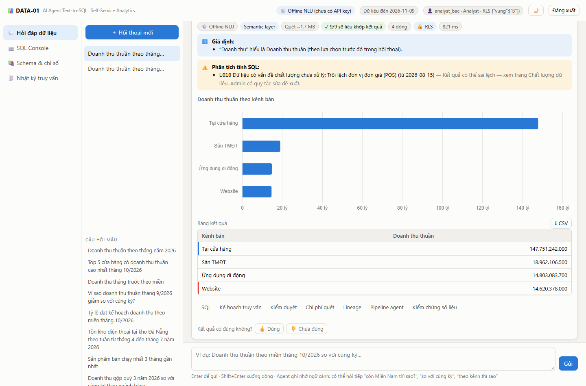
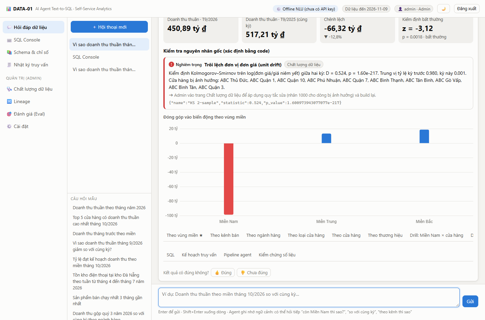

# DATA-01 · AI Agent Text-to-SQL Self-Service Analytics

Agent nhận câu hỏi **tiếng Việt**, tự lập kế hoạch truy vấn, sinh SQL đúng **semantic layer**, kiểm duyệt bằng code
(cú pháp → chỉ đọc → RBAC/RLS → cột PII → dry-run → lint AST → ước lượng bytes quét), **hỏi lại khi mơ hồ**, cho người
dùng **duyệt SQL trước khi chạy trên bảng lớn (HITL)**, chạy trên kho DuckDB, trả về **bảng + biểu đồ + diễn giải có
kiểm chứng số liệu 100%**, tự sửa SQL lỗi, phân tích **nguyên nhân biến động**, và **phát hiện – xử lý sai lệch dữ liệu**
bằng kiểm định thống kê.

Chạy được **ngay không cần API key** (bộ hiểu tiếng Việt offline trên semantic layer). Đặt `OPENROUTER_API_KEY` hoặc
`ANTHROPIC_API_KEY` để bật **LLM function calling** cho câu hỏi tự do; mọi đầu ra của LLM vẫn qua các chốt chặn bằng code.

Hệ thống **không gắn với một doanh nghiệp**: mỗi doanh nghiệp là một *workspace* gồm bộ cấu hình, dữ liệu và bộ câu
hỏi đánh giá riêng. Repo kèm hai doanh nghiệp mẫu thuộc hai ngành khác nhau (bán lẻ điện máy, chuyển phát) và một công
cụ nhận kho dữ liệu mới (mục 2).



---

## 1. Chạy nhanh

Yêu cầu: Python ≥ 3.11.

```powershell
pip install -r requirements.txt
.\run.ps1                 # lần đầu tự sinh dữ liệu giả (~1 phút) rồi mở server
# hoặc: ./run.sh  (Linux/macOS/Git Bash)
```

Mở <http://127.0.0.1:8000> và đăng nhập bằng nút tài khoản demo:

| Tài khoản | Mật khẩu | Vai trò | Ghi chú |
|---|---|---|---|
| `admin` | `admin123` | Admin | Quản trị schema/catalog, chất lượng dữ liệu, lineage, eval, cài đặt; xem mọi log |
| `analyst` | `analyst123` | Analyst | Chỉ đọc tầng `dw`, bị chặn cột PII/lương |
| `analyst_bac` | `analyst123` | Analyst | + **RLS**: chỉ thấy dữ liệu Miền Bắc |
| `analyst_nam` | `analyst123` | Analyst | + **RLS**: chỉ thấy dữ liệu Miền Nam |

Bật LLM: chép `.env.example` thành `.env` ở gốc dự án rồi điền một trong hai khóa (file `.env` được nạp tự động và
đã nằm trong `.gitignore`):

- `OPENROUTER_API_KEY=...` → gọi model qua OpenRouter (mặc định `openai/gpt-6-luna`, đổi bằng `OPENROUTER_MODEL`;
  ở lượt đo mục 6, model này đúng nhiều câu hơn `openai/gpt-4o-mini` với chi phí thấp hơn).
- `ANTHROPIC_API_KEY=sk-ant-...` → gọi Claude (mặc định `claude-opus-5-5`, effort `medium`, có refusal fallback).

Đổi chế độ/model trong trang **Cài đặt** (Admin). Không có khóa nào thì hệ thống chạy bộ luật offline.

Kiểm thử: `python -m pytest -q tests` (124 test: governance, chi phí, semantic, NLU, audit số liệu, so khớp eval, vòng lặp
gọi tool của LLM bằng client giả, các chốt chặn quanh LLM, đa doanh nghiệp, công cụ nhận kho mới). Không test nào gọi mạng.

---

## 2. Nhiều doanh nghiệp (workspace)

Mỗi tiến trình phục vụ một doanh nghiệp, chọn bằng biến môi trường `WORKSPACE`; dữ liệu, bộ nhớ hội thoại và log của hai
doanh nghiệp nằm ở hai thư mục khác nhau nên không lẫn vào nhau.

```powershell
.\run.ps1                                   # doanh nghiệp mẫu 1: Công ty CP Bán lẻ Điện máy ABC (config/, var/, eval/)
.\run.ps1 -Workspace giaovan_xyz -Port 8001 # doanh nghiệp mẫu 2: Công ty CP Giao vận XYZ (workspaces/giaovan_xyz/)
# Linux/macOS/Git Bash: WORKSPACE=giaovan_xyz PORT=8001 ./run.sh
```

| | ABC (mặc định) | XYZ (`giaovan_xyz`) |
|---|---|---|
| Ngành | bán lẻ điện máy | chuyển phát hàng hóa |
| Schema, kiểu đặt tên | `dw`, cột viết tắt tiếng Việt (`fct_ct_dh.tt`) | `mart`, cột tiếng Anh (`fact_shipment.shipping_fee`) |
| Chỉ số | doanh thu thuần/gộp, tồn kho, tỷ lệ đạt kế hoạch… | số vận đơn, tỷ lệ giao đúng hạn, tỷ lệ hoàn, lợi nhuận vận hành… |
| “Doanh thu” mơ hồ giữa | thuần (Tài chính) và gộp (Kinh doanh) | cước ghi nhận (Kế toán) và cước phát sinh (Kinh doanh) |
| Thuật ngữ mơ hồ riêng | “bán chạy nhất” | “sản lượng” (số đơn hay số kg) |
| Phân quyền theo dòng | theo vùng của cửa hàng/kho | theo miền của bưu cục gửi (`analyst_trung`) |
| Bộ câu hỏi đánh giá | 41 câu (`eval/questions.json`) | 26 câu (`workspaces/giaovan_xyz/eval/questions.json`) |

Hai doanh nghiệp chạy cùng một mã nguồn. Ngoài gói `retail_abc` nói ở cuối mục này, mã không nhắc tên bảng, tên cột
hay tên chỉ số của doanh nghiệp nào; những gì thuộc về doanh nghiệp nằm trong sáu file cấu hình:

| File | Quyết định |
|---|---|
| `profile.yml` | tên, ngành, lời tự giới thiệu, schema phục vụ, cột mốc “ngày dữ liệu mới nhất”, quy ước kho đưa vào prompt, việc trợ lý không làm, câu hỏi mẫu |
| `catalog.yml` | mô tả bảng/cột, cột nhạy cảm, quy tắc lint riêng của kho (`lint:` — fan-out, thiếu lọc trạng thái, chỉ số ảnh chụp) |
| `semantic_layer.yml` | model và đường join, chiều, chỉ số (công thức + bộ lọc + chủ sở hữu), cách gọi riêng (`nlu:`), cấu hình phân tích biến động (`analysis:`), thuật ngữ mơ hồ (`ambiguities:`) |
| `policies.yml` | vai trò, tài khoản, phân quyền theo dòng, ngưỡng chi phí quét |
| `contracts.yml`, `fewshots.yml` | data contract để phát hiện schema drift; ví dụ câu hỏi → SQL đã xác nhận |

**Nhận một kho dữ liệu mới:**

```powershell
python -m app.onboard cong_ty_moi --db duong\dan\kho.duckdb --name "Công ty Mới"
$env:WORKSPACE = "cong_ty_moi"; python -m uvicorn app.main:app
```

Công cụ tính thống kê catalog rồi sinh **nháp** bộ cấu hình từ tên cột, kiểu dữ liệu và thống kê: nhận diện bảng sự kiện
và bảng chiều, đường join qua khóa (kể cả một bảng chiều được nối hai vai), cột phân loại thành chiều, cột số thành chỉ
số tổng, cột có vẻ nhạy cảm. Hệ thống chạy được ngay trên bản nháp, nhưng bản nháp không biết nghiệp vụ: nhãn tiếng
Việt, từ đồng nghĩa, bộ lọc trạng thái của chỉ số và thuật ngữ mơ hồ phải do người hiểu doanh nghiệp viết. Chạy lại
công cụ không ghi đè file đã rà soát; `--stats` chỉ tính lại thống kê khi dữ liệu đổi.

Hai phần viết bằng code cho riêng bán lẻ (kiểm định nguồn POS/ERP và các nguyên nhân gốc như lệch đơn vị giá, hết hàng,
lịch khuyến mãi) chỉ bật khi hồ sơ khai `domain_pack: retail_abc`. Doanh nghiệp khác dùng phần tổng quát: kiểm định độ
tươi, khóa ngoại mồ côi theo các đường join đã khai báo, bất thường số dòng theo ngày, trôi lệch phân phối; phân tích
biến động theo các chiều khai báo hoặc tự chọn.

**Giới hạn hiện tại:** thời gian phải dùng năm chiều tên `ngay, tuan, thang, quy, nam`; kho phải là DuckDB; đổi doanh
nghiệp là khởi động một tiến trình khác chứ chưa chuyển được ngay trên giao diện; phân tích biến động chưa chỉ ra thành
phần gây biến động cho chỉ số dạng tỷ lệ.

---

## 3. Kịch bản demo (10 phút)

1. **analyst** → *“Doanh thu tháng trước theo miền”* → agent **hỏi lại** “doanh thu gộp hay thuần?” (2 phòng ban định
   nghĩa khác nhau) → chọn *thuần* → bảng + biểu đồ + diễn giải; badge `✓ 9/9 số liệu khớp kết quả`.
2. Hỏi tiếp *“còn Miền Nam thì sao?”*, *“so với cùng kỳ năm ngoái”* → agent **nhớ ngữ cảnh** và lựa chọn định nghĩa.
3. *“Doanh thu thuần theo cửa hàng”* (toàn bộ lịch sử, ~33 MB) → **chờ duyệt (HITL)**: xem/sửa SQL, bảng chi phí theo
   bảng/cột/phân vùng → Duyệt & chạy. Tab *Kiểm duyệt*, *Chi phí quét*, *Lineage*, *Pipeline agent*, *Kiểm chứng số liệu*.
4. Đăng nhập **analyst_bac**, hỏi *“Doanh thu thuần theo miền tháng 10/2026”* → chỉ ra Miền Bắc (RLS tiêm vào AST).
5. **SQL Console**: chạy câu mẫu có cột sai `thanh_tien` → agent **tự sửa** thành `tt` (theo mô tả catalog), cảnh báo
   `YEAR(ngay_dh)` làm mất cắt phân vùng. Thử `DROP TABLE`, `SELECT * FROM dw.dim_kh`, `read_csv(...)` → bị chặn.
6. **admin** → *“Vì sao doanh thu thuần tháng 9/2026 giảm so với cùng kỳ?”* → phân rã đóng góp theo 6 chiều, drill-down,
   kiểm định z-score, **KS test phát hiện đơn giá bị ghi theo nghìn đồng** ở 10 cửa hàng TP.HCM → kết luận *lỗi dữ liệu*.
7. *“Vì sao doanh thu thuần Miền Trung tháng 6/2026 giảm?”* → chỉ ra ngành **Điện thoại** + **tồn kho kho Đà Nẵng ≈ 0**
   (hết hàng) → nguyên nhân *kinh doanh*.
8. **Chất lượng dữ liệu** → finding *Trôi lệch đơn vị đơn giá (POS)* → **Áp dụng quy tắc sửa** (được kiểm duyệt AST) →
   build lại raw → stg → dw → doanh thu tháng 9 được khôi phục (bảng trước/sau). Có nút **Hoàn tác**.
9. **Lineage**: sơ đồ raw → staging → dw; bấm cột `dw.fct_ct_dh.tt` để truy ngược tới `raw.pos_ct_don_hang.don_gia`...
10. **Đánh giá (Eval)**: chạy bộ 41 câu → execution accuracy theo độ khó; **Tối ưu few-shot (train → dev)**.



---

## 4. Kiến trúc

```
Trình duyệt (web/: HTML + JS thuần + Chart.js)
        │  JWT (HS256, tương thích Supabase Auth)
FastAPI (app/main.py) ──► Agent (app/agent.py) — đồ thị trạng thái kiểu LangGraph:
   load_context ─► planner ─┬─► clarify (hỏi lại, lưu lựa chọn vào bộ nhớ hội thoại)
                            ├─► responder (định nghĩa chỉ số / schema / DQ / trợ giúp)
                            ├─► variance_analyst (insights.py: phân rã, drill-down, kiểm định, nguyên nhân gốc)
                            └─► sql_generator ─► optimizer ─► validator ⇄ repairer (rule-based / LLM)
                                                                 │
                                                  cost_guard ── HITL (chờ duyệt) ── executor ─► analyst ─► explainer ─► finalize (log, bộ nhớ)
   planner = chốt chặn bằng code (câu giới thiệu, SQL đã xác nhận, thuật ngữ mơ hồ)
             ─► LLM function calling qua OpenRouter hoặc Claude (search_schema, describe_table, get_column_values,
                dry_run_sql, compile_semantic_plan, submit_answer), có bản nháp kế hoạch của bộ luật để kiểm tra
             ─► NLU tiếng Việt offline (nlu.py) khi không có LLM hoặc LLM lỗi
        │
DuckDB read-only (enable_external_access=false, lock_configuration, timeout) ◄─ kho của workspace đang chọn
```

Đầu ra của LLM không được tin ngay. Kế hoạch truy vấn được chuẩn hóa và đối chiếu với kho (`app/semantic.py`): giá trị
lọc sai chính tả được đưa về đúng, giá trị không tồn tại bị trả lại kèm danh sách hợp lệ thay vì cho ra kết quả rỗng.
Thuật ngữ mơ hồ do doanh nghiệp khai báo được hỏi lại bằng code trước khi gọi LLM. Phân tích nguyên nhân chỉ chạy cho
câu hỏi “vì sao”, nhận diện bằng code chứ không theo nhãn của mô hình. Vòng lặp gọi tool dừng sớm khi mô hình lặp cùng
một lời gọi lỗi và buộc nộp bài ở lượt cuối.

| Thành phần | File | Ghi chú |
|---|---|---|
| Semantic layer (dbt semantic model) | `config/semantic_layer.yml`, `app/semantic.py` | 25 chỉ số có chủ sở hữu, 24 chiều, 7 model; derived & đa bảng sự kiện, so sánh kỳ, HAVING, semi-additive |
| Data catalog | `config/catalog.yml`, `app/catalog.py` | mô tả cột viết tắt, độ nhạy (PII/mật); Admin sửa trực tiếp |
| Governance | `config/policies.yml`, `app/governance.py` | RBAC theo schema & cột, RLS bằng AST rewrite, chặn DDL/DML/hàm file |
| Chi phí quét | `app/cost.py` | bytes = Σ dòng sau cắt phân vùng × độ rộng cột tham chiếu; ngưỡng cảnh báo / duyệt / chặn theo vai trò |
| Phân tích tĩnh & lineage | `app/sqlcheck.py`, `app/lineage.py` | lint L001–L010 (fan-out, semi-additive, thiếu lọc trạng thái, không sargable…), đối chiếu định nghĩa chỉ số, lineage cột tới raw |
| Diễn giải có kiểm chứng | `app/explain.py` | facts có công thức tái tính; văn bản chỉ chèn số qua placeholder; audit mọi token số |
| Sửa lỗi & tối ưu SQL | `app/repair.py` | sửa cột/bảng/GROUP BY/fan-out/chia 0; viết lại `YEAR()`/`STRFTIME()` thành khoảng ngày |
| Phân tích biến động | `app/insights.py` | z-score (MoM/YoY), phân rã theo “lift”, drill-down, số đơn × giá trị đơn, KS test unit drift, đóng cửa hàng, hết hàng, lịch KM |
| Chất lượng & drift | `app/dq.py` | schema drift (data contract), mapping, trùng, mồ côi, unit drift (change-point + KS), outlier ×10, volume, PSI + chi-square, freshness; quy tắc sửa + rebuild |
| RAG schema & few-shot | `app/retriever.py`, `config/fewshots.yml` | BM25 (thay được bằng Qdrant/pgvector), tái sử dụng SQL đã xác nhận |
| Eval & tự tối ưu | `eval/questions.json`, `app/evals.py` | Execution accuracy chuẩn Spider 2.0; học few-shot từ lỗi train, đo trên dev |
| LLM | `app/llm.py` | hai client cùng giao diện: OpenRouter (API kiểu OpenAI, gọi bằng thư viện chuẩn) và Claude (tool use, structured outputs, prompt caching, `fallbacks: "default"`) |
| Hồ sơ doanh nghiệp & workspace | `config/profile.yml`, `app/profile.py`, `app/config.py` | lời tự giới thiệu dựng bằng code, chọn doanh nghiệp bằng `WORKSPACE` |
| Nhận kho dữ liệu mới | `app/onboard.py` | thống kê catalog và nháp cấu hình cho một kho DuckDB bất kỳ |

---

## 5. Bộ dữ liệu giả

`warehouse/generate.py` sinh kho dữ liệu của chuỗi bán lẻ điện máy hư cấu (43 cửa hàng, 5 kho, ~300 SKU,
01/01/2025 → 09/11/2026, ~547k đơn, ~900k dòng) từ **7 hệ thống nguồn** với dữ liệu bẩn thực tế:

| Nguồn | Bảng raw | “Bẩn” có chủ đích |
|---|---|---|
| POS cửa hàng | `pos_don_hang`, `pos_ct_don_hang`, `pos_cua_hang` | mã trạng thái lẫn lộn (`HT`, `ht`, `Hoàn thành`), số lượng âm, tiền CK NULL, giá gõ thừa số 0 |
| E-commerce | `ecom_orders`, `ecom_order_items` | cột tiếng Anh, ngày dạng chuỗi `DD/MM/YYYY`, `COMPLETED `/`canceled`/`pending_review`, dòng trùng, cột mới `voucher_code` |
| CRM | `crm_khach_hang` | tỉnh viết nhiều kiểu (`tp hcm`, `Sài Gòn`, `HN`…), giới tính `M/Nam/nam/Male`, trùng SĐT |
| ERP | `erp_san_pham`, `erp_ton_kho`, `erp_nhap_kho`, `erp_tra_hang` | tồn kho tuần (semi-additive), phiếu nhập, trả hàng |
| HR | `hr_nhan_vien` | lương (dữ liệu mật) |
| Tài chính | `fin_ke_hoach` | kế hoạch doanh thu tháng × cửa hàng |
| Marketing | `mkt_chi_phi` | chi phí theo tháng × kênh |

Model (`warehouse/models.sql`) làm sạch thành 4 bảng staging và **18 bảng dw** (`fct_ct_dh`, `fct_dh`, `fct_th`,
`fct_tk_tuan`, `fct_nk`, `fct_kh_dt`, `fct_cp_mkt`, 11 dimension) với tên cột viết tắt như kho thật.

**Sự cố cài sẵn để agent phát hiện:** (1) toàn bộ POS TP.HCM ghi đơn giá theo *nghìn đồng* từ 15/08/2026; (2) hết hàng
điện thoại ở kho Đà Nẵng tháng 6/2026; (3) cửa hàng Hải An đóng cửa 30/04/2026; (4) mã trạng thái chưa map; (5) dòng trùng,
số lượng âm, giá ×10; (6) khách trùng SĐT, đơn tham chiếu khách chưa có trong CRM; (7) schema drift `voucher_code`;
(8) ngày cuối nạp thiếu ~60%. Quy mô chỉnh bằng `python warehouse/generate.py --scale 0.5`.

Doanh nghiệp mẫu thứ hai có bộ sinh riêng, `workspaces/giaovan_xyz/warehouse/generate.py`: công ty chuyển phát hư cấu
với 31 bưu cục, 4.000 khách hàng, khoảng 247 nghìn vận đơn từ 01/01/2025 đến 31/10/2026, 6 bảng trong schema `mart`.
Ba sự kiện cài sẵn cho câu hỏi “vì sao”: mưa bão Miền Trung 10–25/06/2026 làm tỷ lệ giao đúng hạn giảm; khách hàng
doanh nghiệp lớn nhất Miền Nam ngừng gửi từ 01/09/2026; một bưu cục đóng cửa ngày 01/04/2026. Kho này sạch (không có
tầng raw/staging), nên phần kiểm định nguồn bẩn và quy tắc sửa chỉ minh họa được trên ABC.

---

## 6. Kết quả đo

Execution accuracy trên bộ câu hỏi của từng doanh nghiệp, đo ngày 12/11/2026, **mỗi cấu hình một lượt chạy**:

| Doanh nghiệp | Chế độ | Đúng | Theo độ khó (easy · medium · hard · extra) | Giây/câu | Diễn giải qua audit số liệu |
|---|---|---|---|---|---|
| ABC (41 câu) | bộ luật offline | 36/41 | 100 · 100 · 100 · 28,6 % | 0,3 | 100 % |
| ABC (41 câu) | OpenRouter `openai/gpt-4o-mini` | 38/41 | 100 · 100 · 100 · 57,1 % | 5,8 | 97,3 % |
| ABC (41 câu) | OpenRouter `openai/gpt-6-luna` | 41/41 | 100 · 100 · 100 · 100 % | 6,8 | 100 % |
| XYZ (26 câu) | bộ luật offline | 22/26 | 100 · 100 · 88,9 · 0 % | 0,04 | 100 % |
| XYZ (26 câu) | OpenRouter `openai/gpt-4o-mini` | 25/26 | 100 · 100 · 100 · 66,7 % | 11,8 | 100 % |
| XYZ (26 câu) | OpenRouter `openai/gpt-6-luna` | 26/26 | 100 · 100 · 100 · 100 % | 6,2 | 100 % |

Ở các lượt LLM trên, không câu nào rơi về bộ luật offline; mỗi câu tốn trung bình 2,2 lượt gọi API. Chi phí đo bằng số
dư OpenRouter cho cả 67 câu của hai doanh nghiệp: khoảng 0,08 USD với `gpt-4o-mini`, khoảng 0,02 USD với `gpt-6-luna`.

Cách đọc các con số này:

- Các câu “extra” nằm ngoài semantic layer (top khách hàng, danh sách có điều kiện, trung bình theo thứ trong tuần…).
  Bộ luật offline không diễn đạt được nên sai gần hết; LLM tự viết SQL qua `dry_run_sql`.
- Bộ câu hỏi do người xây hệ thống viết và đã được dùng để sửa lỗi, nên kết quả lạc quan hơn so với câu hỏi của người
  dùng thật. Cùng một cấu hình chạy lại có thể lệch 1–2 câu.
- Con số của chế độ LLM chỉ có nghĩa khi biết câu đó thật sự do LLM trả lời: khi LLM lỗi, agent chuyển sang bộ luật
  offline và ghi chú trong câu trả lời. Kịch bản đo ghi lại chế độ thực tế của từng câu.
- **Chế độ Claude chưa được đo** vì chưa có khóa Anthropic; vòng lặp gọi tool của Claude mới được kiểm bằng client giả.
- Chức năng tự tối ưu few-shot (học từ lỗi trên tập train, đo trên tập dev) có sẵn ở trang Đánh giá nhưng chưa được đo
  lại sau các thay đổi này.

---

## 7. API chính

`POST /api/login` · `POST /api/chat` · `POST /api/approve` · `POST /api/sql/validate` · `POST /api/sql/run` ·
`POST /api/feedback` · `GET /api/schema` · `PUT /api/admin/catalog` · `GET /api/logs` (+ `.csv`) · `GET|POST /api/dq…` ·
`GET /api/lineage` · `POST /api/eval/run` · `POST /api/eval/optimize` · `GET|PUT /api/admin/settings`. Tài liệu tự sinh:
<http://127.0.0.1:8000/docs>.

## 8. Triển khai

`Dockerfile` sinh dữ liệu lúc build (`DATA_SCALE=0.5`); `render.yaml` cho Render (Railway dùng chung Dockerfile).
Đặt `APP_SECRET`, tùy chọn `ANTHROPIC_API_KEY`, `SUPABASE_JWT_SECRET` (đăng nhập bằng Supabase Auth, vai trò lấy từ
`app_metadata.role`, RLS từ `app_metadata.rls`).

## 9. Khác biệt so với techstack gợi ý & hướng mở rộng

- **Frontend** là HTML/JS thuần + Chart.js (giao diện test, không cần build) thay cho Next.js + Recharts; API đã tách
  sẵn để thay frontend.
- **LangGraph** → đồ thị trạng thái tự viết cùng mô hình node/edge (không thêm phụ thuộc, trace từng node trên UI).
- **Vector DB** → BM25 local; interface `search_schema/search_fewshots` thay được bằng Qdrant/pgvector.
- **Warehouse** → DuckDB (mô phỏng phân vùng theo ngày & bytes-scanned kiểu BigQuery); SQL dialect qua sqlglot nên
  chuyển sang BigQuery/Snowflake/Trino chủ yếu là đổi `DIALECT` và connector.
- NLU offline chỉ bao phủ các câu hỏi biểu diễn được bằng semantic layer; câu tự do cần LLM.
