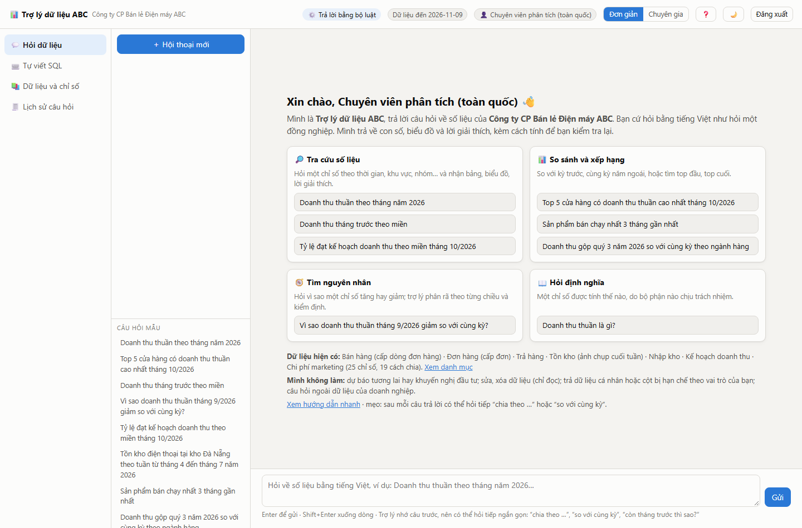
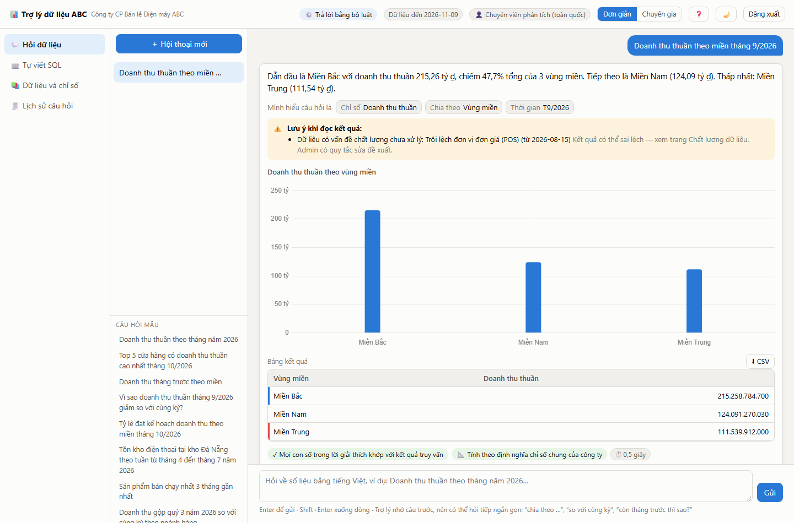

# 02 · Hướng dẫn sử dụng cho người mới

Không cần biết SQL. Nếu hệ thống chưa chạy, xem [03 · Chạy trên máy cá nhân](03-chay-local.md) trước.

## 1. Đăng nhập

Mở địa chỉ của hệ thống (chạy trên máy mình thì là <http://127.0.0.1:8000>). Màn hình đăng nhập có sẵn các nút tài
khoản dùng thử; bấm vào một nút là vào.

| Tài khoản | Mật khẩu | Thấy gì |
|---|---|---|
| `admin` | `admin123` | Mọi dữ liệu và các trang quản trị |
| `analyst` | `analyst123` | Dữ liệu toàn quốc, không thấy cột nhạy cảm (số điện thoại, lương) |
| `analyst_bac` | `analyst123` | Như trên, nhưng chỉ dữ liệu Miền Bắc |
| `analyst_nam` | `analyst123` | Như trên, nhưng chỉ dữ liệu Miền Nam |

Doanh nghiệp mẫu thứ hai (Giao vận XYZ) có `admin`, `analyst` và `analyst_trung` (chỉ Miền Trung), cùng mật khẩu.

Nên bắt đầu bằng `analyst`.

## 2. Màn hình chính

- **Giữa:** lời chào và bốn thẻ việc trợ lý làm được. Mỗi thẻ có câu hỏi mẫu, bấm vào là hỏi luôn.
- **Dưới:** ô gõ câu hỏi.
- **Trái:** danh sách trang và các cuộc hội thoại cũ.
- **Góc trên bên phải:** nút chuyển **Đơn giản / Chuyên gia**, nút ❓ hướng dẫn nhanh, nút đổi nền sáng/tối.

Giữ chế độ **Đơn giản** khi mới dùng. Chế độ Chuyên gia có cùng tính năng nhưng hiện sẵn các nhãn kỹ thuật.

## 3. Hỏi thế nào

Một câu hỏi tốt nêu đủ ba thứ: **số gì**, **thời gian nào**, **chia theo gì**.

| Muốn | Ví dụ (doanh nghiệp ABC) |
|---|---|
| Tra một con số | Doanh thu thuần theo miền tháng 10/2026 |
| So sánh | Doanh thu thuần quý 3/2026 so với cùng kỳ năm trước |
| Xếp hạng | Top 5 cửa hàng có doanh thu thuần cao nhất tháng 10/2026 |
| Tìm nguyên nhân | Vì sao doanh thu thuần tháng 9/2026 giảm so với cùng kỳ? |
| Hỏi định nghĩa | Doanh thu thuần là gì? |
| Hỏi về trợ lý | Bạn là ai? Bạn làm được gì? |

Hỏi nối tiếp được: sau câu đầu, gõ *“còn Miền Nam thì sao?”* hoặc bấm một gợi ý ở dòng **Hỏi tiếp**. Trợ lý nhớ ngữ
cảnh trong cùng cuộc hội thoại.

## 4. Đọc câu trả lời

| Phần | Ý nghĩa |
|---|---|
| **Mình hiểu câu hỏi là…** | Trợ lý nhắc lại chỉ số, thời gian, cách chia đã dùng. **Đọc dòng này trước.** Nếu khác ý bạn, hỏi lại rõ hơn |
| Bảng và biểu đồ | Kết quả truy vấn |
| Lời giải thích | Tóm tắt điểm đáng chú ý trong bảng |
| ✓ xanh “Mọi con số… khớp” | Từng con số trong lời giải thích đã được tính lại từ bảng và khớp |
| 📐 “Tính theo định nghĩa chung” | Con số dùng công thức đã thống nhất của công ty. Nếu ghi là trợ lý tự viết truy vấn thì nên xem kỹ hơn |
| Lưu ý khi đọc kết quả | Điều cần biết về dữ liệu, ví dụ có vấn đề chất lượng đã biết trong kỳ đó |
| Chỉ số này được tính thế nào | Định nghĩa và bộ phận chịu trách nhiệm |
| Hỏi tiếp | Gợi ý bấm được |
| Xem chi tiết kỹ thuật | Câu lệnh SQL, các bước kiểm tra, chi phí, nguồn gốc dữ liệu |
| **Cảnh báo vàng** | Mô hình ngôn ngữ gặp lỗi, bộ luật có sẵn đã trả lời thay. Câu trả lời vẫn dùng được với câu hỏi về chỉ số, nhưng câu hỏi tự do có thể không được hiểu đủ |

## 5. Ba tình huống hay gặp

**Trợ lý hỏi lại.** Một số từ có nhiều cách tính. Hỏi *“doanh thu tháng trước theo miền”*, trợ lý sẽ hỏi bạn muốn
doanh thu gộp hay thuần, vì hai phòng ban định nghĩa khác nhau. Chọn một; trợ lý nhớ lựa chọn trong cuộc hội thoại đó.

**Trợ lý chờ bạn duyệt.** Câu hỏi quét nhiều dữ liệu (ví dụ toàn bộ lịch sử theo từng cửa hàng) sẽ dừng lại. Bạn
xem ước lượng dung lượng, bấm **Duyệt & chạy**, hoặc thu hẹp thời gian rồi hỏi lại.

**Trợ lý từ chối.** Xảy ra khi câu hỏi cần dữ liệu ngoài quyền của tài khoản (cột nhạy cảm, miền khác), ngoài phạm
vi (dự báo, khuyến nghị đầu tư), hoặc yêu cầu sửa xóa dữ liệu. Hệ thống chỉ đọc.

## 6. Các trang khác

| Trang | Dùng để | Ai thấy |
|---|---|---|
| 💬 Hỏi dữ liệu | Hỏi đáp | Mọi người |
| ⌨️ Tự viết SQL | Người biết SQL tự viết truy vấn; hệ thống vẫn kiểm tra quyền và chi phí, tự sửa lỗi thường gặp | Mọi người |
| 📚 Dữ liệu và chỉ số | Xem có những chỉ số, cách chia và bảng nào | Mọi người |
| 🧾 Lịch sử câu hỏi | Các câu đã hỏi và truy vấn đã chạy | Mọi người (admin thấy của tất cả) |
| 🩺 Chất lượng dữ liệu | Vấn đề dữ liệu được phát hiện tự động và cách xử lý | Admin |
| 🔀 Nguồn gốc dữ liệu | Mỗi bảng, mỗi cột được tạo từ nguồn nào | Admin |
| 🎯 Đo độ chính xác | Chạy bộ câu hỏi kiểm tra | Admin |
| ⚙️ Cài đặt | Chế độ trả lời, mô hình ngôn ngữ, ngưỡng duyệt | Admin |

## 7. Thử trong 10 phút

Làm lần lượt trên doanh nghiệp ABC:

1. Đăng nhập `analyst`. Hỏi *“Doanh thu tháng trước theo miền”*. Trợ lý hỏi lại; chọn **thuần**.
2. Bấm gợi ý **Chia theo kênh bán** ở dòng Hỏi tiếp.
3. Hỏi *“Doanh thu thuần theo cửa hàng”*. Trợ lý dừng chờ duyệt; bấm duyệt.
4. Đăng xuất, vào `analyst_bac`, hỏi *“Doanh thu thuần theo miền tháng 10/2026”*. Chỉ còn Miền Bắc.
5. Vào trang **Tự viết SQL**, chạy câu mẫu có sẵn. Hệ thống tự sửa tên cột sai và cảnh báo về điều kiện ngày. Thử
   các lệnh ở mục “thử xem hệ thống chặn thế nào”.
6. Đăng nhập `admin`. Hỏi *“Vì sao doanh thu thuần tháng 9/2026 giảm so với cùng kỳ?”*. Trợ lý phân rã theo từng
   chiều và kết luận đây là lỗi dữ liệu (đơn giá bị ghi sai đơn vị ở một nhóm cửa hàng).
7. Hỏi *“Vì sao doanh thu thuần Miền Trung tháng 6/2026 giảm?”*. Lần này là nguyên nhân kinh doanh (hết hàng).

## 8. Mẹo và lưu ý

- Câu trả lời lạ thì đọc lại dòng “Mình hiểu câu hỏi là…”. Phần lớn trường hợp là trợ lý hiểu khác ý bạn.
- Nêu thời gian cụ thể (*tháng 10/2026*) cho kết quả nhanh và ít phải duyệt hơn.
- “Tháng trước”, “hôm nay” tính theo **ngày mới nhất có dữ liệu**, hiện ở thanh trên, không theo ngày trên máy bạn.
- Khi chưa bật mô hình ngôn ngữ, trợ lý chỉ hiểu câu hỏi về chỉ số đã định nghĩa. Thanh trên cho biết đang ở chế độ nào.
- Dữ liệu trong hai doanh nghiệp mẫu là giả lập; đừng dùng con số ở đây cho việc thật.
